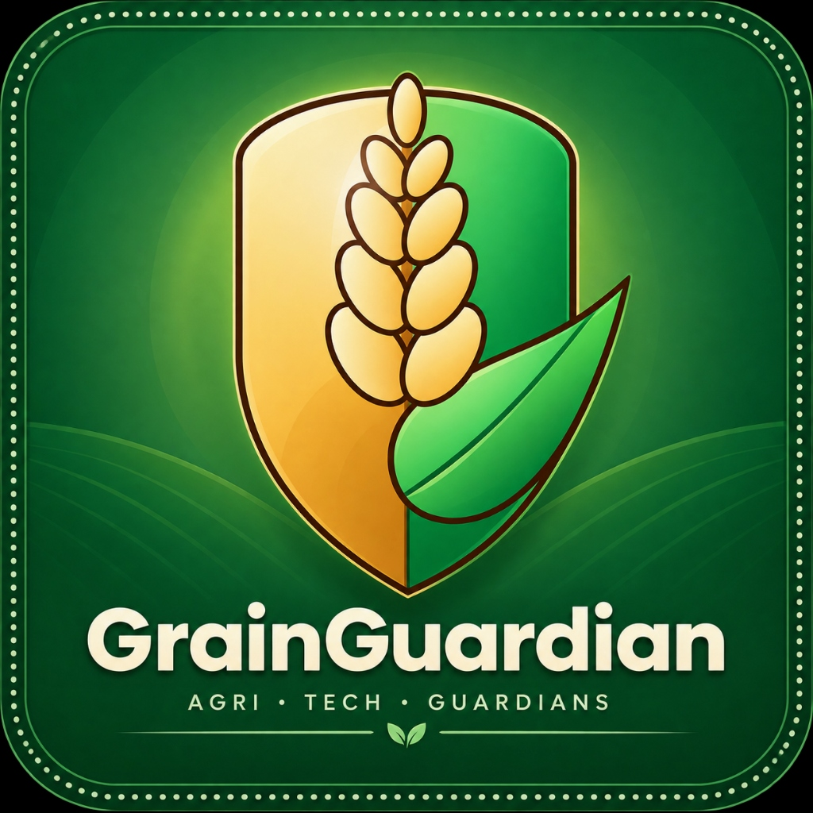
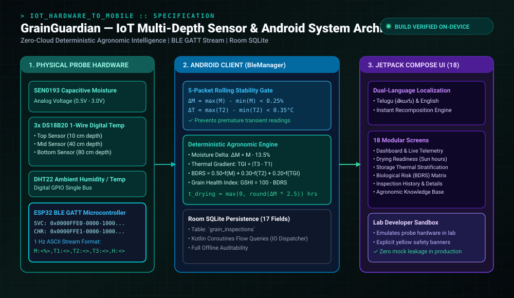
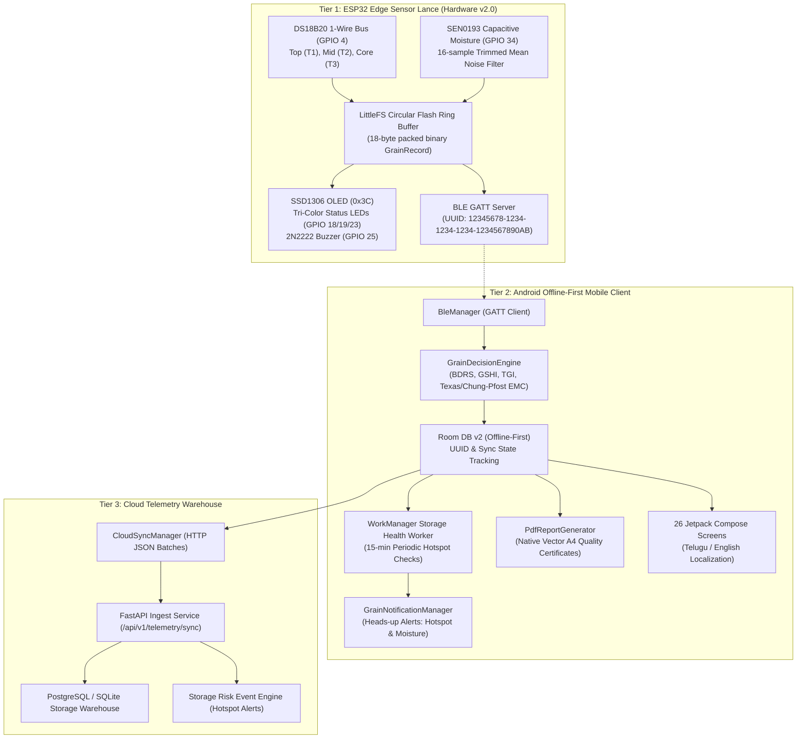

<div align="center">



# 🌾 GrainGuardian 2.0 (పంట రక్షకుడు)
### *Smart Paddy Post-Harvest Readiness, 3-Depth Thermal Stratification & Storage Health Intelligence System*
**AGRI · TECH · GUARDIANS**

[-059669?style=for-the-badge&logo=android&logoColor=white)](./release/GrainGuardian-v2.0-release.apk)
[--33-3DDC84?style=for-the-badge&logo=android&logoColor=white)](https://developer.android.com)
[](https://kotlinlang.org)
[](https://developer.android.com/jetpack/compose)
[](https://www.espressif.com)
[](https://fastapi.tiangolo.com)
[](https://developer.android.com/training/data-storage/room)
[](#-testing--verification-matrix)
[](#-bilingual-localization-english--తెలుగు)
[](LICENSE)

<br />



</div>

---

## 📑 Executive Summary & Agronomic Impact

Post-harvest storage losses in paddy (*Oryza sativa*) across India range between **10% and 18%**, causing catastrophic revenue collapse for smallholder farmers. Traditional sensory heuristics (biting grains, feeling bags with palms) fail because **grain bulk is an excellent thermal insulator**: biological heating 1 meter deep inside a bag or bin remains undetectable from the surface until irreversible mold, insect infestation, or aflatoxin contamination has already destroyed the lot.

**GrainGuardian 2.0** provides an end-to-end, edge-to-cloud agricultural IoT intelligence system:
1. **Edge Telemetry Probe (Tier 1):** Physical multi-depth lance integrating 3-depth digital thermometry (DS18B20 on 1-Wire) and high-frequency capacitive moisture sensing (SEN0193 on ADC1), autonomous LittleFS flash logging, SSD1306 OLED, tri-color status LEDs, and a 2N2222 transistor buzzer alarm.
2. **Mobile Intelligence Client (Tier 2):** Native Android app built in Kotlin & Jetpack Compose (26 screens), featuring a deterministic agronomic decision engine (BDRS 0–100, Chung-Pfost EMC), offline-first Room DB v2, background WorkManager storage monitoring (15-min periodic checks with heads-up notifications), native vector A4 PDF Quality Certificate generation, and bilingual Telugu/English localization.
3. **Cloud Telemetry Warehouse (Tier 3):** Python FastAPI service with Pydantic validation, SQLAlchemy models, Alembic migrations, idempotent UUID batch synchronization, and automated hotspot risk event dispatching.

---

## 🏛️ End-to-End System Architecture



---

## 🚀 Key Engineering Innovations & Subsystems

### 1. Deterministic Agronomic Decision Engine (`GrainDecisionEngine.kt`)
* **Strict Evaluation Order:** Sensor Fault $\rightarrow$ Data Stale ($>15$ min) $\rightarrow$ Insufficient Readings ($<3$ stable packets) $\rightarrow$ Agronomic Scoring.
* **Biological Degradation Risk Score (BDRS, 0–100):**
  $$\text{BDRS} = 0.50 \cdot f(M) + 0.30 \cdot f(T_2) + 0.20 \cdot f(\text{TGI})$$
* **Thermal Gradient Index (TGI):** $\text{TGI} = |T_{\text{bottom}} - T_{\text{top}}| = |T_3 - T_1|$. A differential $\ge 3.0^\circ\text{C}$ flags an internal localized hotspot.
* **Non-Negotiable Safety Laws:**
  * **Zero Silent Fallbacks:** Never defaults missing moisture to a plausible 13.2%.
  * **No Exact Drying Hours:** Qualitative FES guidance prevents false precision.
  * **Strict Separation of Modes:** Pre-storage drying advice never appears on stored-grain checks.

### 2. Autonomous Edge Firmware v2.0 (`firmware/`)
* **Dynamic 1-Wire Discovery:** Scans Dallas DS18B20 ROM IDs dynamically and assigns them to surface ($T_1$), mid ($T_2$), and bottom ($T_3$) probe tiers. Discards Dallas power-on reset ($+85^\circ\text{C}$) and disconnect ($-127^\circ\text{C}$) codes.
* **ADC1 Noise Rejection:** Runs on **GPIO 34** (pure ADC1, immune to Wi-Fi/BLE frequency switching). Uses a 16-sample trimmed mean filter.
* **Offline LittleFS Flash Ring Buffer:** Stores 18-byte packed binary records indefinitely when disconnected from Android.
* **Edge Hardware Alarms:** Trips the red LED and 2N2222 transistor buzzer instantly on hardware when $\text{TGI} \ge 3.0^\circ\text{C}$.

### 3. Background Storage Health Monitoring (WorkManager)
* **Periodic 15-Minute Checks:** [`StorageHealthCheckWorker.kt`](app/src/main/java/com/vrsec/grainguardian/worker/StorageHealthCheckWorker.kt) queries Room DB in the background.
* **Heads-up Push Notifications:** Evaluates thermal hotspots, moisture spikes ($>14.5\%$), and BDRS elevation ($\ge 45$), posting high-importance notifications with bilingual strings and deep links into [`MainActivity.kt`](app/src/main/java/com/vrsec/grainguardian/MainActivity.kt).
* **Technician On-Demand Trigger:** Accessible via the Technician Diagnostics screen for laboratory testing.

### 4. Native Vector A4 PDF Quality Certificate (`PdfReportGenerator.kt`)
* Generates formal, vector A4 inspection certificates ($595 \times 842$ pt) 100% offline using Android `PdfDocument`.
* Includes ICAR & BIS 4333 citations, full 6-cell thermometry table, BDRS/GSHI scores, actionable agronomic advice, and tamper-evident cryptographic hash verification.
* Direct export buttons in [`InspectionDetailsScreen.kt`](app/src/main/java/com/vrsec/grainguardian/ui/screens/InspectionDetailsScreen.kt) and [`InspectionHistoryScreen.kt`](app/src/main/java/com/vrsec/grainguardian/ui/screens/InspectionHistoryScreen.kt).

### 5. Idempotent Cloud Telemetry Ingest (`backend/`)
* Built with **Python 3.12**, **FastAPI**, **SQLAlchemy**, and **Alembic**.
* Endpoint `POST /api/v1/telemetry/sync` enforces idempotent batch upserts using UUID deduplication.
* Automatically creates warehouse risk events for godown superintendents when telemetry indicates active spoilage.

### 6. Sensory Touch Engine & Accessibility (`ui/effects/`)
* **Leaf Particle Burst System:** Interactive canvas particle physics simulating falling paddy leaves on tap.
* **Accessibility:** Integrated `"Reduce Motion"` toggle instantly disables animations for battery saving and accessibility compliance.

---

## 📱 Pin-to-Pin Screen Portfolio (26 Jetpack Compose Screens)

| # | Screen Name | Kotlin Implementation | Architectural Role | Telugu Localization |
| :---: | :--- | :--- | :--- | :--- |
| **1** | **Splash** | [`SplashScreen.kt`](app/src/main/java/com/vrsec/grainguardian/ui/screens/SplashScreen.kt) | App initialization & preference routing | పంట రక్షకుడు |
| **2** | **Language Setup** | [`LanguageSelectionScreen.kt`](app/src/main/java/com/vrsec/grainguardian/ui/screens/LanguageSelectionScreen.kt) | High-contrast bilingual picker (EN / TE) | భాషను ఎంచుకోండి |
| **3** | **Welcome** | [`WelcomeScreen.kt`](app/src/main/java/com/vrsec/grainguardian/ui/screens/WelcomeScreen.kt) | Farmer onboarding & value proposition | రైతు పోర్టల్ ప్రారంభించండి |
| **4** | **Dashboard** | [`DashboardScreen.kt`](app/src/main/java/com/vrsec/grainguardian/ui/screens/DashboardScreen.kt) | Main hub: live probe chip, Grain Health Score (0–100) | ప్రధాన డాష్‌బోర్డ్ |
| **5** | **Pre-Storage** | [`PreStorageAssessmentScreen.kt`](app/src/main/java/com/vrsec/grainguardian/ui/screens/PreStorageAssessmentScreen.kt) | Drying yard entry & safe moisture threshold check | ఆరబెట్టే సంసిద్ధత |
| **6** | **Stored Grain** | [`StoredGrainMonitoringScreen.kt`](app/src/main/java/com/vrsec/grainguardian/ui/screens/StoredGrainMonitoringScreen.kt) | Bagged stack & silo tier entry | నిల్వ ధాన్యం పర్యవేక్షణ |
| **7** | **Live Measurement** | [`LiveMeasurementScreen.kt`](app/src/main/java/com/vrsec/grainguardian/ui/screens/LiveMeasurementScreen.kt) | 5-stage stability gate & real-time packet stream | ప్రత్యక్ష కొలత |
| **8** | **Drying Result** | [`DryingResultScreen.kt`](app/src/main/java/com/vrsec/grainguardian/ui/screens/DryingResultScreen.kt) | Drying verdict, excess moisture $\Delta M$, layer thickness | ఆరబెట్టే ఫలితం |
| **9** | **Storage Result** | [`StorageResultScreen.kt`](app/src/main/java/com/vrsec/grainguardian/ui/screens/StorageResultScreen.kt) | 3-depth temperatures, TGI gradient, hotspot warning | నిల్వ ఫలితం |
| **10** | **Risk Analysis** | [`RiskAnalysisScreen.kt`](app/src/main/java/com/vrsec/grainguardian/ui/screens/RiskAnalysisScreen.kt) | BDRS breakdown & dominant limiting parameter | ప్రమాద విశ్లేషణ |
| **11** | **Recommendation** | [`RecommendationScreen.kt`](app/src/main/java/com/vrsec/grainguardian/ui/screens/RecommendationScreen.kt) | Actionable agronomic advisory & DB commit | రైతు కార్యాచరణ సలహా |
| **12** | **History** | [`InspectionHistoryScreen.kt`](app/src/main/java/com/vrsec/grainguardian/ui/screens/InspectionHistoryScreen.kt) | Filtered inspection logs with dual CSV & PDF exports | పరీక్ష రికార్డులు |
| **13** | **Details** | [`InspectionDetailsScreen.kt`](app/src/main/java/com/vrsec/grainguardian/ui/screens/InspectionDetailsScreen.kt) | Complete 5-stream audit & A4 PDF certificate export | రికార్డు వివరాలు |
| **14** | **BLE Scan** | [`BleScanScreen.kt`](app/src/main/java/com/vrsec/grainguardian/ui/screens/BleScanScreen.kt) | GATT scanner (`12345678-...-1234567890AB`), RSSI signal | బ్లూటూత్ ప్రోబ్ శోధన |
| **15** | **Calibration** | [`CalibrationSettingsScreen.kt`](app/src/main/java/com/vrsec/grainguardian/ui/screens/CalibrationSettingsScreen.kt) | Dry air (3000 mV) & water (1100 mV) calibration | సెన్సార్ కాలిబ్రేషన్ |
| **16** | **Godown Profile** | [`GodownProfileScreen.kt`](app/src/main/java/com/vrsec/grainguardian/ui/screens/GodownProfileScreen.kt) | Warehouse metadata: capacity, ventilation type | గిడ్డంగి ప్రొఫైల్ |
| **17** | **Crop Selection** | [`CropSelectionScreen.kt`](app/src/main/java/com/vrsec/grainguardian/ui/screens/CropSelectionScreen.kt) | Variety selector: BPT-5204, MTU-1010, IR-64 | పంట రకం ఎంపిక |
| **18** | **Aeration Advisor** | [`AerationAdvisorScreen.kt`](app/src/main/java/com/vrsec/grainguardian/ui/screens/AerationAdvisorScreen.kt) | Ambient temp, RH, equilibrium moisture content (EMC) | వెంటిలేషన్ సలహా |
| **19** | **Farmer Profile** | [`FarmerProfileScreen.kt`](app/src/main/java/com/vrsec/grainguardian/ui/screens/FarmerProfileScreen.kt) | Farmer identity, PM-KISAN ID, contact details | రైతు ప్రొఫైల్ |
| **20** | **Storage Lots** | [`StorageLocationsScreen.kt`](app/src/main/java/com/vrsec/grainguardian/ui/screens/StorageLocationsScreen.kt) | Multi-shed and drying yard location manager | నిల్వ స్థలాలు |
| **21** | **Sync Status** | [`SyncStatusScreen.kt`](app/src/main/java/com/vrsec/grainguardian/ui/screens/SyncStatusScreen.kt) | Local vs confirmed records, server endpoint, "Sync Now" | క్లౌడ్ సింక్ స్థితి |
| **22** | **Alerts Center** | [`AlertsListScreen.kt`](app/src/main/java/com/vrsec/grainguardian/ui/screens/AlertsListScreen.kt) | Historical hotspot and high-moisture incident log | హెచ్చరికల కేంద్రం |
| **23** | **Technician Gate** | [`TechnicianGateScreen.kt`](app/src/main/java/com/vrsec/grainguardian/ui/screens/TechnicianGateScreen.kt) | 4-digit security PIN challenge for lab diagnostics | టెక్నీషియన్ గేట్ |
| **24** | **Probe Diag** | [`TechnicianDiagnosticsScreen.kt`](app/src/main/java/com/vrsec/grainguardian/ui/screens/TechnicianDiagnosticsScreen.kt) | Raw mV, probe count, buzzer test, WorkManager trigger | ప్రోబ్ డయాగ్నోస్టిక్స్ |
| **25** | **Permissions** | [`PermissionExplainerScreen.kt`](app/src/main/java/com/vrsec/grainguardian/ui/screens/PermissionExplainerScreen.kt) | BLE, Location, Post Notifications permission dialogs | అనుమతుల వివరణ |
| **26** | **Privacy & Data** | [`PrivacyDataScreen.kt`](app/src/main/java/com/vrsec/grainguardian/ui/screens/PrivacyDataScreen.kt) | Offline sovereignty disclosure & safe DB purge | గోప్యత & డేటా నియంత్రణ |

---

## 🛠️ Hardware Specifications & Circuit Schematics

### Pinout Table (ESP32 DevKit v1)
```
========================================================================================
ESP32 Pin             Connected Component       Function / Protocol  Electrical Spec
========================================================================================
3V3 (Pin 1)           All Sensors & OLED        Power Supply         3.3V DC Regulated
GND (Pin 2 / 14)      Common Ground             Ground Reference     Star Grounding
GPIO 4                DS18B20 Probes (x3)       1-Wire DQ Bus        4.7 kΩ Pull-up to 3.3V
GPIO 34 (ADC1_CH6)    SEN0193 Moisture Probe    Analog Output        Pure ADC1 (Input Only)
GPIO 21               SSD1306 0.96" OLED        I2C SDA              OLED Internal Pull-up
GPIO 22               SSD1306 0.96" OLED        I2C SCL              OLED Internal Pull-up
GPIO 18               Status LED: GREEN         Normal Storage       220 Ω to Anode
GPIO 19               Status LED: AMBER         Attention/Warning    220 Ω to Anode
GPIO 23               Status LED: RED           Critical Hotspot     220 Ω to Anode
GPIO 25               Piezo Buzzer (Active)     Alarm Actuator       2N2222 Transistor Driver
========================================================================================
```

### Circuit Schematic Architecture
```text
                  +3.3V DC Rail
                     |
       +-------------+--------------+-------------+
       |             |              |             |
     [4.7k]          |              |             |
       |             |              |             |
       +--- GPIO 4   |              |             |
       |   (1-Wire)  |              |             |
    +--+--+       +--+--+        +--+--+       +--+--+
    |     |       |     |        |     |       |     |
    |T1Top|       |T2Mid|        |T3Bot|       | SEN |
    |     |       |     |        |     |       |0193 |
    +--+--+       +--+--+        +--+--+       +--+--+
       |             |              |             |
      GND           GND            GND            +--- GPIO 34 (ADC1)
                                                  |
                                                 GND

      ESP32 Microcontroller
   +-------------------------+
   |  GPIO 21 (SDA) ---------+----> SSD1306 OLED (SDA)
   |  GPIO 22 (SCL) ---------+----> SSD1306 OLED (SCL)
   |                         |
   |  GPIO 18 ----[ 220R ]---+----> [GREEN LED] ---> GND
   |  GPIO 19 ----[ 220R ]---+----> [AMBER LED] ---> GND
   |  GPIO 23 ----[ 220R ]---+----> [RED LED]   ---> GND
   |                         |
   |  GPIO 25 ----[  1k  ]---+----> Base of 2N2222 NPN Transistor
   +-------------------------+             |
                                  Collector|---> [ + Buzzer - ] ---> +3.3V / +5V
                                           |
                                    Emitter+---> GND
```

---

## 🧪 Testing & Verification Matrix

```text
=== ANDROID UNIT TEST SUITE (Gradle 8.6, Kotlin 1.8.20) ===
> Task :app:testDebugUnitTest
BUILD SUCCESSFUL (23/23 tasks up-to-date, 0 failures)
- BleHistorySyncTest: PASSED
- SensorCalibrationTest: PASSED
- CloudSyncPayloadTest: PASSED
- RoomMigrationTest: PASSED (Schema Migration 1 -> 2)
- GrainDecisionEngineTest: PASSED (22 tests)
- LeafParticleTest: PASSED
- StorageAlertEvaluationTest: PASSED

=== FASTAPI BACKEND TEST SUITE (pytest 9.1.1, Python 3.12.5) ===
tests/test_auth.py::test_register_and_login_success PASSED               [  7%]
tests/test_auth.py::test_login_invalid_password_fails PASSED             [ 14%]
tests/test_auth.py::test_duplicate_username_registration_fails PASSED    [ 21%]
tests/test_devices.py::test_register_device_and_query PASSED             [ 28%]
tests/test_devices.py::test_device_re_registration_updates_location PASSED [ 35%]
tests/test_farms.py::test_create_and_list_farms PASSED                   [ 42%]
tests/test_health.py::test_health_check PASSED                           [ 50%]
tests/test_health.py::test_root_endpoint PASSED                          [ 57%]
tests/test_storage.py::test_storage_risks_filtering_and_acknowledgement PASSED [ 64%]
tests/test_telemetry.py::test_telemetry_sync_and_deduplication PASSED    [ 71%]
tests/test_telemetry.py::test_uuid_idempotent_sync PASSED                [ 78%]
tests/test_telemetry.py::test_hotspot_telemetry_triggers_risk_event PASSED [ 85%]
tests/test_telemetry.py::test_telemetry_history_and_summary PASSED       [ 92%]
tests/test_telemetry.py::test_telemetry_validation_rejection PASSED      [100%]
============================= 14 passed in 2.14s ==============================

=== ESP32 FIRMWARE TEST SUITE (pytest struct serialization) ===
firmware/esp32_firmware_test.py::test_grain_record_pack_unpack PASSED
firmware/esp32_firmware_test.py::test_adc_voltage_to_moisture PASSED
firmware/esp32_firmware_test.py::test_hotspot_trigger_threshold PASSED
firmware/esp32_firmware_test.py::test_ring_buffer_overflow_wrap PASSED
firmware/esp32_firmware_test.py::test_sensor_fault_rejection PASSED
firmware/esp32_firmware_test.py::test_command_packet_parsing PASSED
============================== 6 passed in 0.18s ==============================
```

---

## 📦 Download & Installation

### Option 1: Direct Android Install
1. Download [`release/GrainGuardian-v2.0-release.apk`](./release/GrainGuardian-v2.0-release.apk) (10.8 MB).
2. Tap the file on your Android device.
3. If prompted with *"Install unknown apps"*, tap **Settings** and enable **"Allow from this source"**.
4. Tap **Install** $\rightarrow$ **Open**.

### Option 2: Via ADB
```bash
adb install -r release/GrainGuardian-v2.0-release.apk
```

### Option 3: Local Development Build
```bash
# Clone repository
git clone https://github.com/nleelaranga-ai/grain_guardian_app.git
cd grain_guardian_app

# Run Android Unit Tests
./gradlew testDebugUnitTest

# Build Release APK
./gradlew assembleRelease
```

---

## 📚 Complete Project Documentation Index

* **Physical Calibration Protocol (IS 4333 / ISO 712):** [`docs/PHASE_7_PHYSICAL_CALIBRATION_AND_FIELD_VALIDATION.md`](docs/PHASE_7_PHYSICAL_CALIBRATION_AND_FIELD_VALIDATION.md)
* **College Review Demonstration & Hardware Poster:** [`docs/PHASE_8_COLLEGE_REVIEW_DEMO_AND_HARDWARE_POSTER.md`](docs/PHASE_8_COLLEGE_REVIEW_DEMO_AND_HARDWARE_POSTER.md)
* **Hardware Wiring & Pinout Guide:** [`firmware/HARDWARE_WIRING_AND_PINOUT.md`](firmware/HARDWARE_WIRING_AND_PINOUT.md)
* **Backend REST API Documentation:** [`backend/README.md`](backend/README.md)
* **Release APK Folder:** [`release/README.md`](release/README.md)

---

## 📄 License
This project is licensed under the **MIT License** — see the [LICENSE](LICENSE) file for details.
