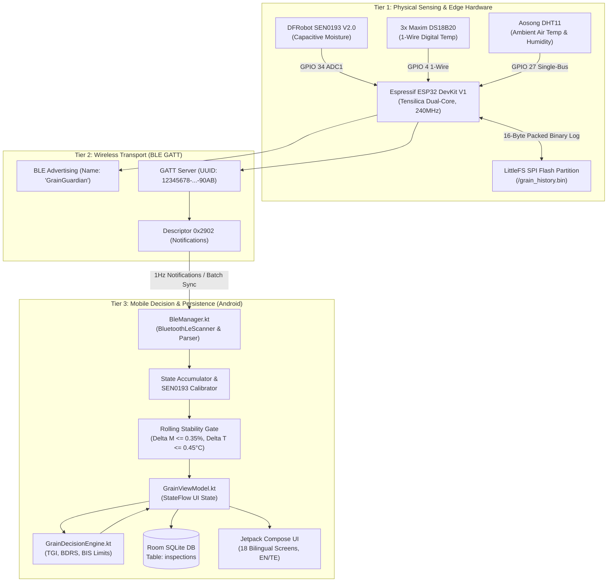

# GrainGuardian — System Architecture Specification v2.0

**Status:** Verified Edge-First Architecture  
**Platforms:** ESP32 Hardware Probe, Android Native Client (`com.vrsec.grainguardian`), Local SQLite Database

---

## 1. Architectural Philosophy: Offline-First Edge Resilience

Rural agricultural environments in developing economies impose severe operational constraints:
1. **Connectivity Deserts:** Drying yards (*kallalu*) and storage godowns operate with zero reliable 4G/5G coverage.
2. **Intermittent Power:** Farm field sheds lack grid power; battery-powered portable operation is mandatory.
3. **Immediate Operational Decision Latency:** Farmers cannot wait for cloud round-trips to know if grain must be bagged before rain.

GrainGuardian adopts an **Offline-First Edge Architecture**. The microcontroller and smartphone perform 100% of sensor acquisition, signal filtering, safety classification, and historical persistence locally. Cloud integration is strictly an optional synchronization layer for centralized cooperative warehousing, not an operational prerequisite.

---

## 2. Multi-Tier Subsystem Hierarchy

---

## 3. Physical Probe Specifications

The probe consists of a 1-meter rigid non-conductive PVC shaft designed for grain pile insertion:
- **Top Layer (10 cm depth):** $T_1$ DS18B20 digital temperature probe. Measures surface heat loss and ambient solar boundary.
- **Middle Layer (40 cm depth):** $T_2$ DS18B20 digital temperature probe. Senses core moisture migration and thermal inversion.
- **Bottom Layer (80 cm depth):** $T_3$ DS18B20 digital temperature probe + SEN0193 capacitive moisture probe mounted in an acrylic shoe. Measures maximum stack pressure and deep biological hotspot development.

---

## 4. Subsystem Responsibilities

### ESP32 Edge Firmware
- Periodic sampling loop (2s active BLE, 5m autonomous sleep-logging).
- ADC1 dedicated sampling (`GPIO 34`) to prevent silicon conflict with BLE baseband.
- LittleFS circular buffer logging for up to 65,536 offline records (227 days).
- BLE command interface (`CMD:INFO`, `CMD:SYNC`, `CMD:CLEAR_HISTORY`).

### Android Client Application
- Reactive MVVM architecture with Kotlin Coroutines and StateFlow.
- Multi-packet stream accumulator preventing asynchronous state wipeouts.
- Mathematical rolling stability gate requiring 4 contiguous stable reading cycles.
- Room database persistence with deduplication and reactive query invalidation.
- Full runtime localization (English and natural Telugu).
