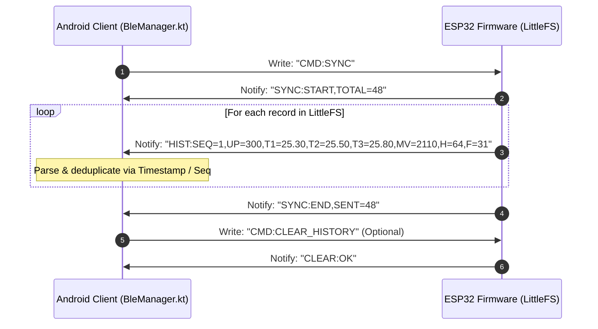

# GrainGuardian — Bluetooth Low Energy (BLE) Protocol Specification v2.0

**Document Version:** 2.0.0  
**Status:** Implemented & Verified  
**Scope:** GATT profile, advertisement payload, streaming telemetry format, and offline historical batch synchronization protocol.

---

## 1. GATT Profile Hierarchy

```
GATT Server: "GrainGuardian"
│
└── Primary Service: 12345678-1234-1234-1234-1234567890AB
    │
    └── Telemetry & Command Characteristic: 12345678-1234-1234-1234-1234567890AC
        ├── Properties: READ | NOTIFY | WRITE
        └── Descriptor: 0x2902 (Client Characteristic Configuration Descriptor - CCCD)
```

- **Device Name:** `GrainGuardian` (Broadcasted in BLE advertising and scan response)
- **Primary Service UUID:** `12345678-1234-1234-1234-1234567890AB`
- **Telemetry Characteristic UUID:** `12345678-1234-1234-1234-1234567890AC`
- **Fallback Base UUIDs (Supported by BleManager.kt):**  
  Service: `0000FFE0-0000-1000-8000-00805F9B34FB`, Characteristic: `0000FFE1-0000-1000-8000-00805F9B34FB`

---

## 2. Real-Time Telemetry Mode (Streaming)

When a mobile client connects and enables notifications via CCCD (`0x2902`), the ESP32 streams live readings every 2000 ms.

### Packet Sequence
To fit within standard default BLE MTU (23 bytes, 20 payload bytes) without requiring MTU negotiation, individual key-value notifications are spaced 40–60 ms apart:

```
[ESP32] -> Notify: "T1=25.38"   // Top DS18B20 temperature in °C
[ESP32] -> Notify: "T2=25.56"   // Middle DS18B20 temperature in °C
[ESP32] -> Notify: "T3=25.94"   // Bottom DS18B20 temperature in °C
[ESP32] -> Notify: "AIR=24.9"   // Ambient DHT11 air temperature in °C
[ESP32] -> Notify: "HUM=64.4"   // Ambient relative humidity in % RH
[ESP32] -> Notify: "MR=2368"    // Raw 12-bit ADC value (0-4095)
[ESP32] -> Notify: "MV=2110"    // Factory calibrated analog millivolts
```

### Sensor Disconnection & Fault Tokens
If a physical sensor fails or disconnects during streaming:
- `T1=ERR` / `T2=ERR` / `T3=ERR` (Triggered when 1-Wire returns `DEVICE_DISCONNECTED_C` / `-127.00°C`)
- `AIR=ERR` / `HUM=ERR` (Triggered when DHT11 fails checksum or returns `NaN`)

The Android client (`BleManager.kt`) detects `ERR` tokens and flags the corresponding sensor status to `false`, preventing false-safe assessment verdicts.

---

## 3. Command & Control Protocol (Phone $\rightarrow$ ESP32)

Commands are written as UTF-8 strings to Characteristic `12345678-1234-1234-1234-1234567890AC`:

| Command String | Direction | Description | Expected Firmware Response |
| :--- | :---: | :--- | :--- |
| `CMD:INFO` | Phone $\rightarrow$ ESP | Query firmware version, record count, and uptime | `INFO:VER=2.0;RECS=<count>;UP=<seconds>` |
| `CMD:SYNC` | Phone $\rightarrow$ ESP | Request batch transfer of all offline records from LittleFS | Initiates `SYNC:START` batch stream |
| `CMD:CLEAR_HISTORY` | Phone $\rightarrow$ ESP | Delete LittleFS `/grain_history.bin` and reset sequence | `CLEAR:OK` |

---

## 4. Offline History Synchronization Protocol

When the ESP32 operates autonomously (Mode B), it logs records every 5 minutes to LittleFS. Upon reconnection, the mobile application issues `CMD:SYNC`.

### Sync Session Handshake



### Historical Record Payload Syntax
Format: `HIST:SEQ=<id>,UP=<sec>,T1=<t1>,T2=<t2>,T3=<t3>,MV=<mv>,H=<hum>,F=<flags>`

- `SEQ`: Monotonically increasing 32-bit sequence ID.
- `UP`: Seconds elapsed since ESP32 boot.
- `T1, T2, T3`: Multi-depth temperatures in °C (or `ERR`).
- `MV`: SEN0193 millivolts for moisture conversion.
- `H`: Relative humidity integer percentage.
- `F`: Bitfield flags (`Bit0`: T1 OK, `Bit1`: T2 OK, `Bit2`: T3 OK, `Bit3`: Moisture OK, `Bit4`: DHT OK).

### Timestamp Reconstitution Formula
Because the low-cost ESP32 does not contain a battery-backed DS3231 RTC, the exact wall-clock timestamp of each offline record is reconstituted by Android:

$$T_{\text{record}} = T_{\text{sync}} - (U_{\text{current}} - U_{\text{record}}) \times 1000\text{ ms}$$

Where:
- $T_{\text{sync}}$: Current Android system time (`System.currentTimeMillis()`).
- $U_{\text{current}}$: ESP32 current uptime in seconds (from `INFO:UP=...`).
- $U_{\text{record}}$: Record uptime in seconds (`HIST:UP=...`).
